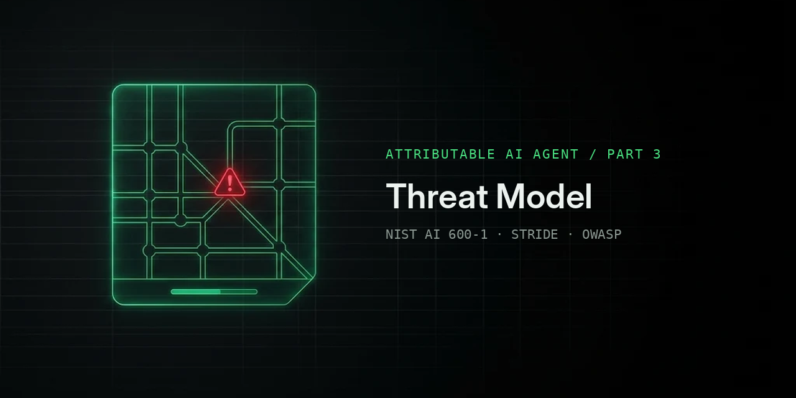

# Part 3: Threat Model
Part 3 threat models the agent built in Parts 1 and 2 (Foundry Agent and its API Management gateway), mapping each threat and risk to the control that covers it, the evidence that proves it, or the gap that remains.
| File | What it covers | Status |
|---|---|---|
| nist-ai-600-1.md | NIST AI 600-1 GenAI risk triage | Done |
| architecture.md | Data flow diagram with trust boundaries | Planned |
| stride.md | STRIDE threats per element and per interaction | Planned |
| owasp-llm.md | OWASP LLM Top 10 (2026) quick pass | Planned |
| owasp-agentic.md | OWASP Agentic Top 10 mapping | Planned |
| gaps.md | Consolidated gap backlog | Planned |
