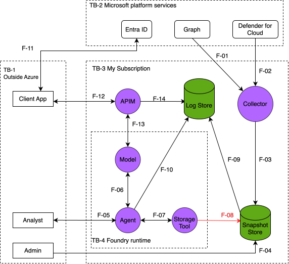

# Architecture and data flows

Scope: the lab build in my own Azure tenant (Parts 1 and 2), not a production system. All data is synthetic.

| Shape | Element type |
|---|---|
| Rectangle | External entity |
| Circle | Process |
| Cylinder | Data store |
| Dashed box | Trust boundary |
| Red arrow | Partial control (see [stride.md](stride.md)) |

## Trust boundaries

| ID | Boundary | Contains | Why it's a boundary |
|---|---|---|---|
| TB‑1 | Outside Azure | Analyst, Admin, Client app | Untrusted until authenticated |
| TB‑2 | Microsoft platform services | Entra ID, Microsoft Graph, Defender for Cloud | Run by Microsoft; tokens and data are consumed as issued |
| TB‑3 | My subscription | Collector, APIM, Snapshot store, Log store | I configure these resources, their identities and their role assignments |
| TB‑4 | Foundry runtime (inside TB‑3) | Agent, Model, Storage tool | Runs in my subscription, but the platform controls runtime identities and internal auth |

## Data flows

| ID | Flow | What moves | Identity | Crosses |
|---|---|---|---|---|
| F‑01 | Graph → Collector | Identity metrics | Collector managed identity | TB‑2 → TB‑3 |
| F‑02 | Defender for Cloud → Collector | Secure score and recommendations | Collector managed identity (Security Reader, subscription scope) | TB‑2 → TB‑3 |
| F‑03 | Collector → Snapshot store | JSON snapshot | Collector managed identity (Blob Data Contributor, snapshots container only) | — |
| F‑04 | Admin → Snapshot store | Synthetic snapshots and the prompt injection test file | Admin user account | TB‑1 → TB‑3 |
| F‑05 | Analyst ↔ Agent | Question in, cited answer out | Analyst's Entra sign-in | TB‑1 ↔ TB‑4 |
| F‑06 | Agent ↔ Model | Instructions, question and snapshot text in; completion out | Platform-internal | — |
| F‑07 | Agent ↔ Storage tool | Snapshot request out; file contents back | Platform-internal | — |
| F‑08 | Storage tool → Snapshot store | Read (GET) | Shared Foundry identity, not the agent identity | TB‑4 → TB‑3 |
| F‑09 | Snapshot store → Log store | Storage read, write and delete logs | Azure diagnostic settings | — |
| F‑10 | Agent → Log store | Agent traces through Application Insights | Project managed identity | TB‑4 → TB‑3 |
| F‑11 | Client app ↔ Entra ID | Certificate assertion out; access token back | Client app certificate | TB‑1 ↔ TB‑2 |
| F‑12 | Client app ↔ APIM | Model request with bearer token; response, 401 or 429 back | Access token (JWT) | TB‑1 ↔ TB‑3 |
| F‑13 | APIM ↔ Model | Forwarded request; completion | APIM managed identity | TB‑3 ↔ TB‑4 |
| F‑14 | APIM → Log store | Gateway logs with the verified caller app ID | Azure diagnostic settings | — |

## Assumptions

- Managed identities and the agent identity get their tokens from Entra ID. The platform handles that exchange, so it isn't drawn.
- F-06 and F-07 authenticate inside Foundry and can't be configured, so they're treated as platform trust.
- The Activity log isn't drawn as a flow. It's the evidence for admin actions in [stride.md](stride.md).

## Method

STRIDE per element on all 13 elements, then STRIDE per interaction on the 9 flows that cross a trust boundary. Results are in [stride.md](stride.md).
